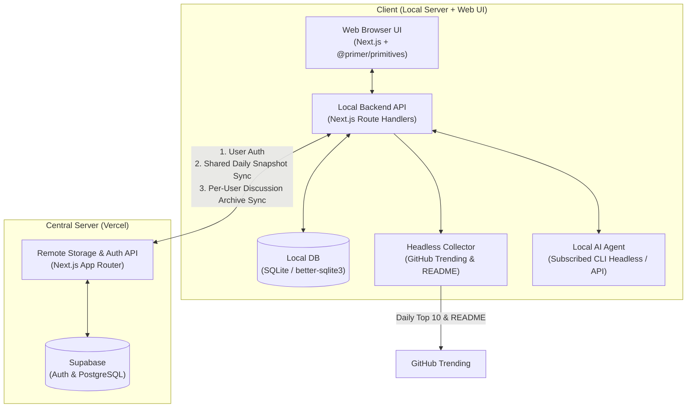

# GitHub Trend Agent

> **매일 0시 기준 GitHub Star TOP 10을 수집·요약하고, 사용자의 로컬 AI 에이전트와 실시간 토론한 인사이트를 계정별로 영구 보관하는 플랫폼**

---

## 1. 프로젝트 개요

매일 새롭게 주목받는 GitHub 오픈소스 저장소(TOP 10)를 살펴보면서 핵심 내용을 요약해 두고, 궁금한 점을 AI 에이전트와 깊이 있게 토론한 뒤 그 결론까지 한곳에 정리·보관하기 위해 설계된 프로젝트입니다.

중앙 서버가 모든 사용자의 AI 추론과 헤드리스 크롤링 비용을 떠안는 대신, **실질적인 AI 행동과 헤드리스 수집은 사용자의 로컬 클라이언트 서버(`client/`)에서 수행**하고, **중앙 서버(`server/`)는 계정별 데이터의 영구 저장 및 조회만 담당**하는 분산 아키텍처를 채택했습니다.

---

## 2. 핵심 기능

1. **0시(00:00) 기준 일일 GitHub Star TOP 10 (`Daily Trending Snapshot`) 및 3단계 공유 캐싱**
   - 날이 바뀌는 **00:00 정각 기준 날짜 키(`YYYY-MM-DD`)**로 당일 급상승한 GitHub Star TOP 10 저장소와 요약을 제공합니다.
   - 조회 시 **`1차: 클라이언트 로컬 SQLite DB` → `2차: 중앙 서버 Supabase DB` → `3차: 클라이언트 최초 1회 헤드리스 수집·요약 후 양쪽 DB 저장`** 순서로 동작합니다.
   - 어느 한 클라이언트가 당일 한 번이라도 조회하여 중앙 서버에 스냅샷을 등록하면, 이후 접속하는 다른 모든 클라이언트는 중복 크롤링·요약 없이 중앙 서버 데이터를 내려받아 자신의 로컬 DB에 캐싱하여 즉시 사용합니다.

2. **사용자별 구독 AI 연동 (`Local AI Agent`) 및 미연동 사용자 기능 제한 (Capability Gating)**
   - 각 사용자는 자신이 구독 중인 로컬 AI CLI(예: `claude`, `gemini`, `codex` 헤드리스 실행) 또는 개인 API Key를 클라이언트에 연동할 수 있습니다.
   - **AI 모델을 연동한 사용자**: `Repository Digest`(AI 요약) 생성, 실시간 AI 토론(`Discussion Session`), 토론 핵심 정리(`Discussion Archive`) 등 모든 AI 에이전트 기능 사용 가능
   - **AI 모델을 연동하지 않은 사용자**: 이미 생성된 일일 TOP 10 및 아카이브 조회만 가능하며, AI 에이전트를 사용하는 기능은 제한됨

3. **웹 화면 실시간 AI 채팅 토론 (`Discussion Session`)**
   - 관심 있는 TOP 10 저장소를 선택하여 웹 브라우저 채팅 화면에서 해당 레포의 요약 및 `README.md` 컨텍스트를 바탕으로 `Local AI Agent`와 실시간으로 대화를 주고받습니다.

4. **토론 요약 정리 및 계정별 영구 보관 (`Discussion Archive`)**
   - 토론이 끝나면 에이전트가 대화에서 도출된 핵심 결론을 요약·정리하고, 이를 해당 프로젝트의 초기 요약(`Repository Digest`) 및 전체 대화 내역과 함께 묶어 **로그인한 계정(`User`)별로 로컬 DB와 중앙 서버 DB에 저장**합니다.

---

## 3. 시스템 아키텍처

---

## 4. 기술 스택

| 구분 | 구성 요소 | 기술 스택 | 역할 |
| :--- | :--- | :--- | :--- |
| **Client (`client/`)** | 프레임워크 & UI | **Next.js (App Router, TypeScript)** | 웹 화면 렌더링 및 로컬 서버 API 통합 구동 |
| | 디자인 시스템 | **`@primer/primitives`** | GitHub 공식 디자인 토큰(컬러, 타이포그래피, 여백) 통일 |
| | 로컬 데이터베이스 | **SQLite (`better-sqlite3`)** | 당일 스냅샷 로컬 캐싱 및 실시간 토론 세션 상태 관리 |
| | AI & 수집기 | **Headless CLI (`child_process`) / API** | GitHub Trending 수집 및 사용자 구독 AI 실행 |
| **Server (`server/`)** | 프레임워크 | **Next.js (App Router, TypeScript)** | 계정 인증, 일일 스냅샷 공유 및 아카이브 조회/저장 API |
| | 데이터베이스 & 인증 | **Supabase (PostgreSQL & Auth)** | 계정별 데이터 격리 및 영속화 |
| | 배포 환경 | **Vercel** | 가벼운 서버리스 API 배포 |

---

## 5. 도메인 및 아키텍처 문서

- **도메인 용어집**: [`GLOSSARY.md`](./GLOSSARY.md)
  - `Daily Trending Snapshot`, `Trending Repository`, `Repository Digest`, `Discussion Session`, `Discussion Archive`, `User`, `Local AI Agent`
- **아키텍처 결정 기록 (ADR)**: [`docs/adr/`](./docs/adr/)
  - [`0001-local-ai-runner-and-remote-storage.md`](./docs/adr/0001-local-ai-runner-and-remote-storage.md): 로컬 AI 실행기 및 중앙 스토리지 서버 분리
  - [`0002-dual-database-architecture.md`](./docs/adr/0002-dual-database-architecture.md): 로컬 SQLite + 중앙 Supabase 이중 DB 및 일일 스냅샷 공유 캐싱
  - [`0003-headless-cli-ai-and-capability-gating.md`](./docs/adr/0003-headless-cli-ai-and-capability-gating.md): 클라이언트 AI 모델 연동 및 미연동 사용자 기능 제한
  - [`0004-nextjs-supabase-vercel-for-remote-server.md`](./docs/adr/0004-nextjs-supabase-vercel-for-remote-server.md): 중앙 서버 Next.js + Supabase + Vercel 채택
  - [`0005-nextjs-and-sqlite-for-local-client.md`](./docs/adr/0005-nextjs-and-sqlite-for-local-client.md): 클라이언트 로컬 서버 Next.js + SQLite + `@primer/primitives` 채택
- **에이전트 개발 규칙**: [`AGENTS.md`](./AGENTS.md)

---

## 6. 개발 워크플로우 규칙

본 저장소의 모든 작업은 [`AGENTS.md`](./AGENTS.md)에 정의된 5단계 절차를 따릅니다:

1. **GitHub 이슈 기반 시작**: [GitHub Issues](https://github.com/timonPark/github-trend-agent/issues) 및 [Project 보드](https://github.com/users/timonPark/projects/13)에 등록된 이슈를 기반으로 작업을 시작합니다.
2. **규칙 브랜치 생성**: `{이슈번호}-{이슈내용}` 형식으로 브랜치를 생성합니다.
3. **`work_history/` 기록**: [`work_history/`](./work_history/) 내에 작업 마크다운 문서를 생성하고 진행 내역과 완료 일시·상태를 기록합니다.
4. **PR 및 승인 게이트**: 작업 완료 후 `commit → push → PR 생성`까지 수행하며, **반드시 사용자의 승인을 받은 후 머지**합니다.
5. **머지 후 정리**: 머지 완료 후 이슈 정리(Close), 작업 브랜치 삭제, `work_history/` 최종 반영을 수행합니다.
