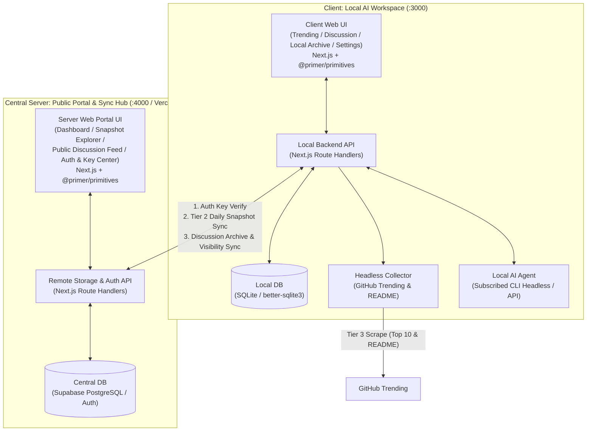
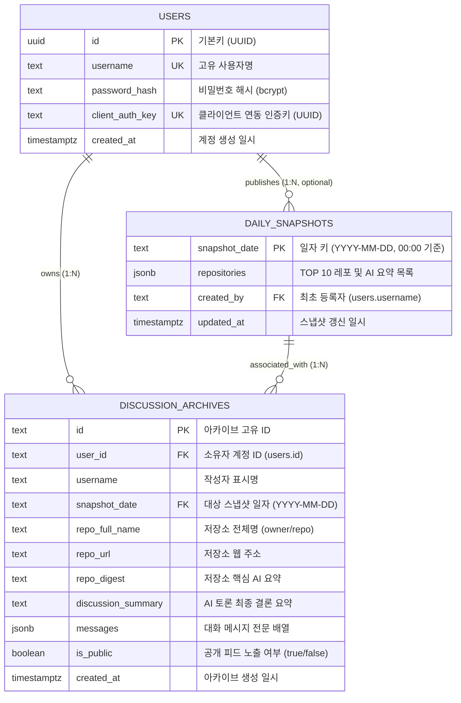
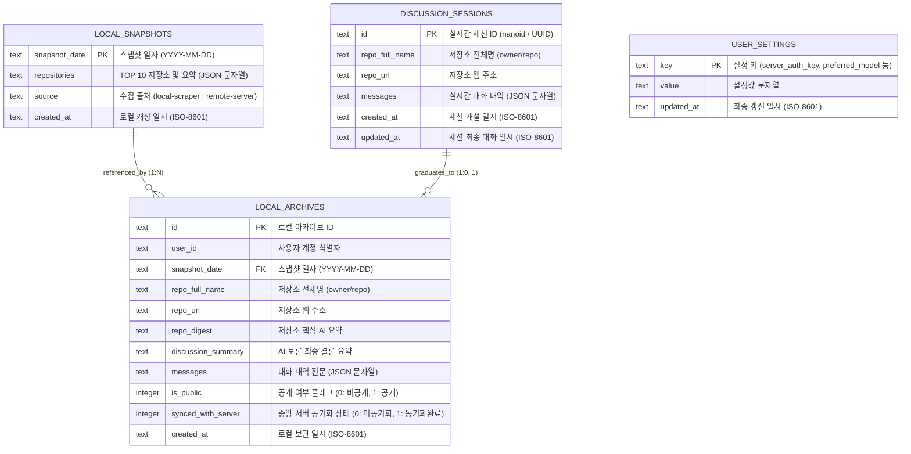
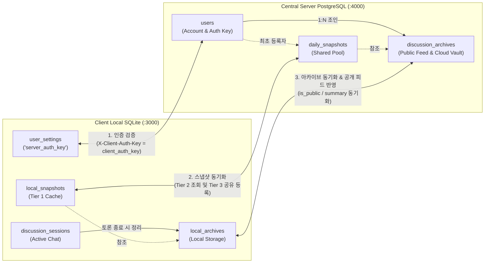

# GitHub Trend Agent

> **매일 0시 기준 GitHub Star TOP 10을 수집·요약하고, 사용자의 로컬 AI 에이전트와 실시간 토론한 인사이트를 계정별로 영구 보관·공유하는 플랫폼**

---

## 1. 프로젝트 개요

매일 새롭게 주목받는 GitHub 오픈소스 저장소(TOP 10)를 살펴보면서 핵심 내용을 요약해 두고, 궁금한 점을 AI 에이전트와 깊이 있게 토론한 뒤 그 결론까지 한곳에 정리·보관하기 위해 설계된 프로젝트입니다.

중앙 서버가 모든 사용자의 AI 추론과 헤드리스 크롤링 비용을 떠안는 대신, **실질적인 AI 추론과 헤드리스 수집은 사용자의 로컬 클라이언트 워크스페이스(`client/`)에서 수행**하고, **중앙 서버(`server/`)는 계정별 데이터의 영구 저장·동기화 허브이자 누구나 트렌딩 스냅샷과 공개 AI 토론 아카이브를 탐색할 수 있는 중앙 웹 포털**을 담당하는 Dual Web UI 분산 아키텍처를 채택했습니다.

---

## 2. 핵심 기능

1. **0시(00:00) 기준 일일 GitHub Star TOP 10 (`Daily Trending Snapshot`) 및 3단계 공유 캐싱**
   - 날이 바뀌는 **00:00 정각 기준 날짜 키(`YYYY-MM-DD`)**로 당일 급상승한 GitHub Star TOP 10 저장소와 요약을 제공합니다.
   - 조회 시 **`1차: 클라이언트 로컬 SQLite DB` → `2차: 중앙 서버 DB` → `3차: 클라이언트 최초 1회 헤드리스 수집·요약 후 양쪽 DB 저장`** 순서로 동작합니다.
   - 어느 한 클라이언트가 당일 한 번이라도 조회하여 중앙 서버에 스냅샷을 등록하면, 이후 접속하는 다른 모든 클라이언트와 중앙 서버 웹 포털 방문자는 중복 크롤링·요약 없이 즉시 열람합니다.

2. **사용자별 구독 AI 연동 (`Local AI Agent`) 및 미연동 사용자 기능 제한 (Capability Gating)**
   - 각 사용자는 자신이 구독 중인 로컬 AI CLI(예: `claude`, `gemini`, `ollama` 헤드리스 실행) 또는 개인 API Key를 클라이언트에 연동할 수 있습니다.
   - **AI 모델을 연동한 사용자**: `Repository Digest`(AI 요약) 생성, 실시간 AI 토론(`Discussion Session`), 토론 핵심 정리(`Discussion Archive`) 등 모든 AI 에이전트 기능 사용 가능
   - **AI 모델을 연동하지 않은 사용자**: 이미 생성된 일일 TOP 10 및 아카이브 조회만 가능하며, AI 에이전트를 사용하는 기능은 제한됨

3. **웹 화면 실시간 AI 채팅 토론 (`Discussion Session`)**
   - 관심 있는 TOP 10 저장소를 선택하여 클라이언트 웹 브라우저 채팅 화면에서 해당 레포의 요약 및 `README.md` 컨텍스트를 바탕으로 `Local AI Agent`와 실시간으로 대화를 주고받습니다.

4. **토론 요약 정리, 계정별 영구 보관 및 공개 공유 (`Discussion Archive` & `Public Discussion Feed`)**
   - 토론이 끝나면 에이전트가 대화에서 도출된 핵심 결론을 요약·정리하고, 이를 해당 프로젝트의 초기 요약(`Repository Digest`) 및 전체 대화 내역, 공개 여부(`is_public`)와 함께 묶어 **로그인한 계정(`User`)별로 로컬 DB와 중앙 서버 DB에 저장**합니다.
   - 사용자가 공개(`is_public: true`)로 설정한 아카이브는 중앙 서버의 **공개 AI 토론 피드(`Public Discussion Feed`)**를 통해 다른 개발자들과 인사이트를 공유할 수 있습니다.

5. **클라이언트 로컬 워크스페이스 & 중앙 서버 공개 웹 포털 (Dual Web UI)**
   - **Client (`client/`, Local `:3000`)**: 인증 게이트(`AuthGate`), 일일 TOP 10 대시보드(`TrendingDashboard`), 실시간 AI 토론방(`DiscussionSession`), 내 로컬 아카이브 보관함(`LocalArchiveViewer`), 로컬 AI & 서버 설정(`SettingsTab`) 제공
   - **Server (`server/`, Remote `:4000`)**: 플랫폼 종합 대시보드(`Dashboard`), 날짜별 TOP 10 스냅샷 보관소(`SnapshotExplorer`), 공개 AI 토론 아카이브 피드(`PublicDiscussionFeed`), 계정 인증 및 클라이언트 연동 키 센터(`Auth & KeyCenter`) 제공

---

## 3. 시스템 아키텍처

---

## 4. 데이터베이스 아키텍처 및 ERD (Dual-DB Model)

본 프로젝트는 **중앙 서버(Supabase PostgreSQL)**와 **클라이언트(로컬 SQLite)**가 독립된 역할을 수행하면서 안전하게 동기화되는 **Dual-DB 분산 아키텍처**를 채택하고 있습니다.

<h3>4.1. 중앙 서버 ERD (Supabase PostgreSQL)</h3>

중앙 서버는 모든 사용자의 계정 인증, 일일 스냅샷 공유 풀, 그리고 공개/비공개 토론 아카이브의 영구 보존소 역할을 담당합니다.

#### 중앙 서버 테이블 상세 명세

| 테이블명 | 컬럼명 | 데이터 타입 | 제약 조건 | 설명 |
| :--- | :--- | :--- | :--- | :--- |
| **`users`** | `id` | `uuid` | PK, Default `gen_random_uuid()` | 계정 고유 식별자 |
| | `username` | `text` | UNIQUE, NOT NULL | 사용자 로그인 아이디 |
| | `password_hash` | `text` | NOT NULL | 단방향 해시 암호화 비밀번호 |
| | `client_auth_key` | `text` | UNIQUE, NOT NULL | 클라이언트 연동용 개인 인증키 (`X-Client-Auth-Key`) |
| | `created_at` | `timestamptz` | NOT NULL, Default `now()` | 계정 생성 일시 |
| **`daily_snapshots`** | `snapshot_date` | `text` | PK | 일자 키 (포맷: `YYYY-MM-DD`, 00:00 정각 기준) |
| | `repositories` | `jsonb` | NOT NULL | 당일 GitHub Star TOP 10 레포지토리 및 AI 요약 배열 |
| | `created_by` | `text` | NULLABLE | 해당 일자 스냅샷을 최초로 등록한 클라이언트 유저명 |
| | `updated_at` | `timestamptz` | NOT NULL, Default `now()` | 스냅샷 최종 갱신 일시 |
| **`discussion_archives`** | `id` | `text` | PK | 아카이브 고유 식별자 (`nanoid` / `uuid`) |
| | `user_id` | `text` | FK (`users.id`), NOT NULL | 아카이브 소유자의 계정 ID |
| | `username` | `text` | NOT NULL | 아카이브 작성자 화면 표시명 |
| | `snapshot_date` | `text` | FK (`daily_snapshots.snapshot_date`) | 토론 대상 스냅샷 일자 |
| | `repo_full_name` | `text` | NOT NULL | 토론 대상 저장소 (`owner/repo`) |
| | `repo_url` | `text` | NOT NULL | GitHub 저장소 원본 URL |
| | `repo_digest` | `text` | NOT NULL | 저장소 최초 핵심 요약 (Digest) |
| | `discussion_summary` | `text` | NOT NULL | AI 에이전트와 나눈 토론의 결론 정리 요약 |
| | `messages` | `jsonb` | NOT NULL | 실시간 토론 대화 메시지 전문 (`role`, `content`, `timestamp`) |
| | `is_public` | `boolean` | NOT NULL, Default `false` | 중앙 서버 공개 피드(`Public Discussion Feed`) 노출 여부 |
| | `created_at` | `timestamptz` | NOT NULL, Default `now()` | 아카이브 생성 및 영구 저장 일시 |

> [!NOTE]
> **Epic 6 계정 인증 고도화 (#49) 예정 컬럼**: 소셜 로그인(GitHub/Google/Kakao/Naver) 및 비밀번호 찾기 연동에 따라 `users` 테이블에 `email (text)`, `oauth_provider (text)`, `oauth_id (text)` 필드가 순차적으로 확장 적용될 예정입니다.

<h3>4.2. 클라이언트 로컬 ERD (SQLite)</h3>

클라이언트는 사용자의 개인 PC 환경에서 구동되며, 불필요한 네트워크 트래픽을 방지하고 빠른 UI 응답성을 위해 로컬 SQLite(`client.db`)를 운용합니다.

#### 클라이언트 테이블 상세 명세

| 테이블명 | 컬럼명 | 데이터 타입 | 제약 조건 | 설명 |
| :--- | :--- | :--- | :--- | :--- |
| **`user_settings`** | `key` | `TEXT` | PK | 로컬 환경 설정 키 (`server_auth_key`, `preferred_model` 등) |
| | `value` | `TEXT` | NOT NULL | 환경 설정 값 |
| | `updated_at` | `TEXT` | NOT NULL | 설정 변경 일시 |
| **`local_snapshots`** | `snapshot_date` | `TEXT` | PK | 일자 키 (`YYYY-MM-DD`) |
| | `repositories` | `TEXT` | NOT NULL | 일일 TOP 10 저장소 및 Digest JSON 문자열 (Tier 1 로컬 캐시) |
| | `source` | `TEXT` | NOT NULL | 수집 출처 (`local-scraper`: 로컬 헤드리스 수집, `remote-server`: 중앙 서버 동기화) |
| | `created_at` | `TEXT` | NOT NULL | 로컬 저장 일시 |
| **`discussion_sessions`** | `id` | `TEXT` | PK | 진행 중인 실시간 AI 토론 세션 ID |
| | `repo_full_name` | `TEXT` | NOT NULL | 토론 대상 레포 (`owner/repo`) |
| | `repo_url` | `TEXT` | NOT NULL | GitHub 저장소 링크 |
| | `messages` | `TEXT` | NOT NULL | 실시간 대화 메시지 목록 JSON 문자열 |
| | `created_at` | `TEXT` | NOT NULL | 세션 개설 일시 |
| | `updated_at` | `TEXT` | NOT NULL | 세션 대화 갱신 일시 |
| **`local_archives`** | `id` | `TEXT` | PK | 완료된 토론 아카이브 ID |
| | `user_id` | `TEXT` | NOT NULL | 로컬 사용자 식별자 |
| | `snapshot_date` | `TEXT` | FK (`local_snapshots.snapshot_date`) | 대상 스냅샷 일자 |
| | `repo_full_name` | `TEXT` | NOT NULL | 토론 대상 레포 |
| | `repo_url` | `TEXT` | NOT NULL | GitHub 저장소 링크 |
| | `repo_digest` | `TEXT` | NOT NULL | 저장소 AI 요약 |
| | `discussion_summary` | `TEXT` | NOT NULL | AI 토론 결론 요약 |
| | `messages` | `TEXT` | NOT NULL | 전체 대화 내역 JSON 문자열 |
| | `is_public` | `INTEGER` | NOT NULL, Default `0` | 공개 여부 (`0`: 비공개, `1`: 공개) |
| | `synced_with_server`| `INTEGER` | NOT NULL, Default `0` | 중앙 서버 동기화 성공 여부 (`0`: 미동기화, `1`: 동기화완료) |
| | `created_at` | `TEXT` | NOT NULL | 아카이브 생성 일시 |

<h3>4.3. Dual-DB 동기화 매핑 및 데이터 흐름</h3>

| 동기화 계층 | 클라이언트 로컬 (SQLite) | 중앙 서버 (PostgreSQL) | 동기화 동작 및 비즈니스 규칙 |
| :--- | :--- | :--- | :--- |
| **인증 연동** | `user_settings.server_auth_key` | `users.client_auth_key` | 클라이언트가 설정한 키를 통해 중앙 서버 API 호출 시 계정을 식별하고 권한을 부여받습니다. |
| **스냅샷 공유** | `local_snapshots` | `daily_snapshots` | **Tier 1 (로컬 SQLite)** 확인 → 없으면 **Tier 2 (중앙 서버)** 조회 후 로컬에 복제 캐시 저장 → 중앙 서버에도 없으면 **Tier 3 (클라이언트 1회 헤드리스 수집)** 후 중앙 서버와 로컬에 동시 등록합니다. |
| **아카이브 영속화** | `local_archives` | `discussion_archives` | 토론 세션(`discussion_sessions`) 완료 시 로컬 아카이브를 생성하고, 중앙 서버로 전송하여 클라우드에 영구 백업(`synced_with_server=1`)합니다. |
| **공개 피드 공유** | `local_archives.is_public` | `discussion_archives.is_public` | 사용자가 공개로 전환하면 중앙 서버의 `Public Discussion Feed`에 즉시 반영되어 다른 모든 개발자가 열람할 수 있습니다. |

---

## 5. 기술 스택

| 구분 | 구성 요소 | 기술 스택 | 역할 |
| :--- | :--- | :--- | :--- |
| **Client (`client/`)** | 프레임워크 & UI | **Next.js (App Router, TypeScript)** | 개인용 로컬 AI 워크스페이스 웹 화면 및 로컬 API 구동 |
| | 디자인 시스템 | **`@primer/primitives`** | GitHub 공식 디자인 토큰(컬러, 타이포그래피, 여백) 통일 |
| | 로컬 데이터베이스 | **SQLite (`better-sqlite3`)** | 당일 스냅샷 로컬 캐싱, 실시간 토론 세션 및 개인 아카이브 관리 |
| | AI & 수집기 | **Headless CLI (`child_process`) / API** | GitHub Trending 수집 및 사용자 구독 AI 어댑터 실행 |
| **Server (`server/`)** | 프레임워크 & 포털 UI | **Next.js (App Router, TypeScript)** | 중앙 공개 웹 포털(대시보드, 스냅샷 탐색기, 공개 토론 피드, 키 센터) 및 동기화 API |
| | 디자인 시스템 | **`@primer/primitives`** | 클라이언트와 일관된 GitHub 디자인 토큰 적용 |
| | 데이터베이스 & 인증 | **Supabase (PostgreSQL & Auth) / SQLite** | 계정별 인증 키 관리, 일일 스냅샷 공유 및 아카이브 영속화 |
| | 배포 환경 | **Vercel** | 중앙 웹 포털 및 서버리스 API 배포 |

---

## 6. 도메인 및 아키텍처 문서

- **도메인 용어집**: [`GLOSSARY.md`](./GLOSSARY.md)
  - `Daily Trending Snapshot`, `Trending Repository`, `Repository Digest`, `Discussion Session`, `Discussion Archive`, `Snapshot Explorer`, `Public Discussion Feed`, `User`, `Local AI Agent`
- **아키텍처 결정 기록 (ADR)**: [`docs/adr/`](./docs/adr/)
  - [`0001-local-ai-runner-and-remote-storage.md`](./docs/adr/0001-local-ai-runner-and-remote-storage.md): 로컬 AI 실행기 및 중앙 스토리지·웹 포털 서버 분리
  - [`0002-dual-database-architecture.md`](./docs/adr/0002-dual-database-architecture.md): 로컬 SQLite + 중앙 DB 이중 구조 및 일일 스냅샷 공유 캐싱
  - [`0003-headless-cli-ai-and-capability-gating.md`](./docs/adr/0003-headless-cli-ai-and-capability-gating.md): 클라이언트 AI 모델 연동 및 미연동 사용자 기능 제한
  - [`0004-nextjs-supabase-vercel-for-remote-server.md`](./docs/adr/0004-nextjs-supabase-vercel-for-remote-server.md): 중앙 서버 Next.js 공개 웹 포털 + Supabase + Vercel 채택
  - [`0005-nextjs-and-sqlite-for-local-client.md`](./docs/adr/0005-nextjs-and-sqlite-for-local-client.md): 클라이언트 로컬 서버 Next.js + SQLite + `@primer/primitives` 채택
- **운영 및 가이드 문서**:
  - [`docs/oauth-provider-setup.md`](./docs/oauth-provider-setup.md): 소셜 로그인(OAuth) 4대 제공자(GitHub, Google, Kakao, Naver) 설정 및 배포 가이드
- **에이전트 개발 규칙**: [`AGENTS.md`](./AGENTS.md)

---

## 7. 개발 워크플로우 규칙

본 저장소의 모든 작업은 [`AGENTS.md`](./AGENTS.md)에 정의된 5단계 절차를 따릅니다:

1. **GitHub 이슈 기반 시작**: [GitHub Issues](https://github.com/timonPark/github-trend-agent/issues) 및 [Project 보드](https://github.com/users/timonPark/projects/13)에 등록된 이슈를 기반으로 작업을 시작합니다.
2. **규칙 브랜치 생성**: `{이슈번호}-{이슈내용}` 형식으로 브랜치를 생성합니다.
3. **`work_history/` 기록**: [`work_history/`](./work_history/) 내에 작업 마크다운 문서를 생성하고 진행 내역과 완료 일시·상태를 기록합니다.
4. **PR 및 승인 게이트**: 작업 완료 후 `commit → push → PR 생성`까지 수행하며, **반드시 사용자의 승인을 받은 후 머지**합니다.
5. **머지 후 정리**: 머지 완료 후 이슈 정리(Close), 작업 브랜치 삭제, `work_history/` 최종 반영을 수행합니다.
